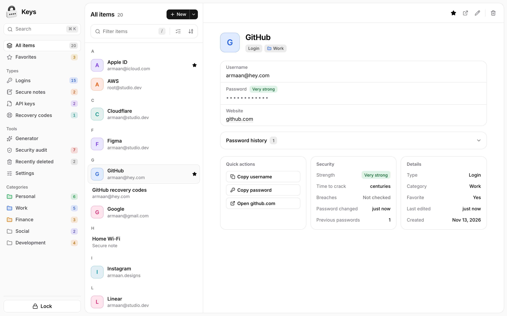
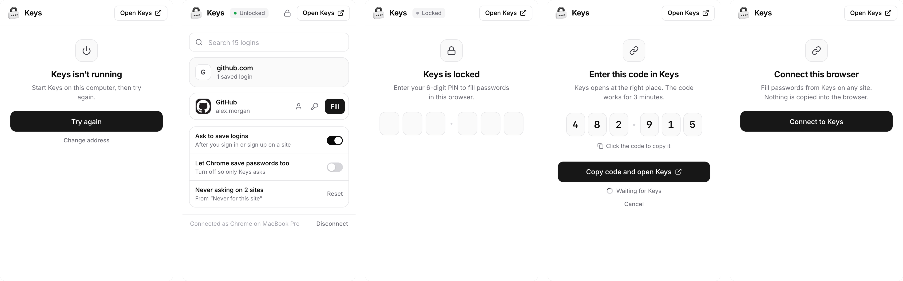

# Keys

Keys is a password manager that runs on your own computer, in your browser. Your passwords are encrypted and kept in one file that you control. There's no account to create and no cloud service in the middle.

## What it does

- **Keeps four kinds of items:** logins, secure notes, API keys and recovery codes. Sort them into categories and star your favorites.
- **Generates passwords**, passphrases and PINs.
- **Checks your passwords.** The security audit finds weak, old and breached passwords, and shows exactly which logins share the same one.
- **Breach checks are optional** and use Have I Been Pwned. Your passwords never leave your computer.
- **Unlocks your way:** a master password or a PIN, plus an optional quick-unlock PIN for a password vault.
- **Has a safety net.** Deleted items go to Recently deleted first, and each item remembers its last 20 passwords.
- **Imports and exports.** Bring logins over from Chrome, Firefox, Safari, 1Password, LastPass or Bitwarden. Export an encrypted backup, JSON or CSV.
- **Feels quick.** Right-click any item for shortcuts, press `⌘K` to search, `N` for a new item and `⌘⇧L` to lock.
- **Light and dark themes**, or follow your system.

## Versions

Each folder is a complete project of its own: `cd` into it and use its npm commands.

| Folder | What it is | Start here |
| --- | --- | --- |
| [keys-web](keys-web) | Keys in the browser, served by Node on your computer | `npm run setup`, `npm run build`, `npm start` |
| [keys-iphone](keys-iphone) | Read-only iPhone web app (opens your file from Google Drive) | `npm install`, `npm run dev` |
| [keys-extension](keys-extension) | Browser extension for Chrome, Edge, Brave… | load the folder in `chrome://extensions` |

They're separate projects that read the same vault file format.

## Where your data lives

Everything is in one SQLite file. By default it's `Keys.sqlite` in your app data folder (`~/Library/Application Support/Keys` on macOS, `%APPDATA%\Keys` on Windows).

You can move it from **Settings → Database** to any folder, iCloud Drive, Google Drive or a USB drive. In a cloud folder, open it on one device at a time.

To back up, make an encrypted export, or copy the file while Keys is stopped.

## Browser extension

Keys has an extension for Chrome, Edge, Brave and other Chromium browsers. It fills your logins on websites and asks before saving a new or changed password. It keeps no copy of your passwords: it asks Keys, and only while Keys is unlocked.

1. Open `chrome://extensions` and turn on **Developer mode**.
2. Drag the [keys-extension](keys-extension) folder onto the page.
3. Click the Keys icon, choose **Connect to Keys**, and paste the code into **Settings → Browser extension**.

A login only fills on its own website, and only after you click it. The extension needs Chrome 120 or newer.

## Security in short

- Your master password unlocks a random vault key, and that key encrypts every item, titles and usernames included.
- The key lives only in memory while Keys is unlocked. Keys locks itself after 5 minutes idle by default.
- Wrong guesses lock you out for longer each time.
- Keys' built-in server only answers your own computer.

A few things to know:

- **A forgotten master password can't be recovered.** Keep an encrypted export somewhere safe.
- **A PIN is much weaker than a password.** Someone with a copy of your file could crack it.
- **Keys can't protect you from malware** on your own computer.

## Privacy

Keys sends nothing about you or your vault to other networked systems. It only connects out for: breach checks (Have I Been Pwned, which only ever receives the first 5 characters of a password's SHA-1 hash), and fetching a website's icon (that website).

## License

[MIT](LICENSE)
