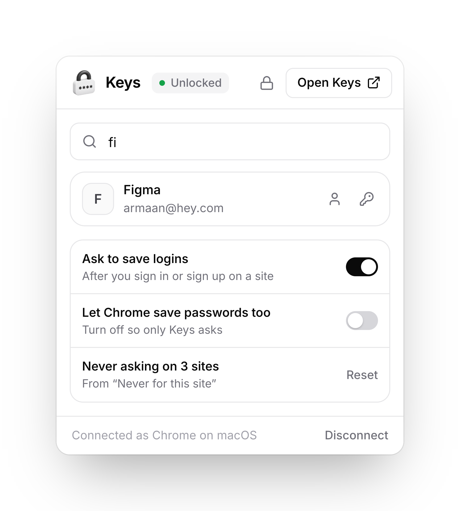

# Keys

Keys is a password manager that runs on your own computer. Your passwords are encrypted and kept in one file that you control. There's no account to create and no cloud service in the middle.

I built it for people who want a private, simple place for their passwords without handing them to a third party.


## What it does

- **Keeps four kinds of items:** logins, secure notes, API keys and recovery codes. Sort them into categories and star your favorites.
- **Generates passwords**, passphrases and PINs.
- **Checks your passwords.** The security audit finds weak, old and breached passwords, and shows exactly which logins share the same one.
- **Breach checks are optional** and use Have I Been Pwned. Your passwords never leave your computer.
- **Unlocks your way:** a password, passphrase, PIN or pattern, plus an optional quick-unlock PIN.
- **Has a safety net.** Deleted items go to Recently deleted first, and each item remembers its last 20 passwords.
- **Imports and exports.** Bring logins over from Chrome, Firefox, Safari, 1Password, LastPass or Bitwarden. Export an encrypted backup, JSON or CSV.
- **Feels quick.** Right-click any item for shortcuts, press `⌘K` to search, `N` for a new item and `⌘⇧L` to lock.
- **Light and dark themes**, or follow your system.

## Built with

- Rust (Tauri, axum) for the Mac and Windows app and its local server
- React, TypeScript and Vite for the interface
- SQLite for storage
- Argon2id and AES-256-GCM for encryption

## Getting started

Download Keys from [Releases](https://github.com/sleepinstead/Keys/releases). **Mac:** unzip it and drag **Keys.app** to Applications. **Windows:** run the setup `.exe` (if Windows says it protected your PC, choose **More info → Run anyway**; the installer isn't code-signed yet). The first time, Keys walks you through a short setup where you choose how to unlock it. It updates itself.

No desktop app for your system yet? Run Keys in the browser instead: see [web/README.md](web/README.md).

To work on the code you need Node.js 24.7+ and Rust. Run `npm install`, then `npm run dev` (the Rust server plus live-reloading UI) and open http://localhost:5173.

## Where your data lives

Everything is in one SQLite file. By default it's `Keys.sqlite` in your app data folder (`~/Library/Application Support/Keys` on macOS).

You can move it from **Settings → Database** to any folder, iCloud Drive, Google Drive or a USB drive. In a cloud folder, open it on one device at a time.

To back up, make an encrypted export, or copy the file while Keys is stopped.

## Browser extension

Keys has an extension for Chrome, Edge, Brave and other Chromium browsers. It fills your logins on websites and asks before saving a new or changed password. It keeps no copy of your passwords: it asks Keys, and only while Keys is unlocked.



1. Download the latest `Keys-extension` zip from [Releases](https://github.com/sleepinstead/Keys/releases) and unzip it.
2. Open `chrome://extensions` and turn on **Developer mode**.
3. Drag the unzipped folder onto the page.
4. Click the Keys icon, choose **Connect to Keys**, and paste the code into **Settings → Browser extension**.

A login only fills on its own website, and only after you click it. The extension needs Chrome 120 or newer.

## Security in short

- Your master password unlocks a random vault key, and that key encrypts every item, titles and usernames included.
- The key lives only in memory while Keys is unlocked. Keys locks itself after 5 minutes idle by default.
- Wrong guesses lock you out for longer each time.
- Keys' built-in server only answers your own computer.

A few things to know:

- **A forgotten master password can't be recovered.** Keep an encrypted export somewhere safe.
- **A PIN or pattern is much weaker than a password.** Someone with a copy of your file could crack it.
- **Keys can't protect you from malware** on your own computer.

## Project layout

```
desktop/     Rust: keys-core (API, encryption, storage) and the desktop app (Mac, Windows)
src/         React interface
shared/      types and the password generator
extension/   browser extension
phone/       read-only iPhone web app
web/         Keys in the browser (Node server for the same interface)
```

Third-party fonts, word lists and libraries are listed in [THIRD_PARTY_NOTICES.md](THIRD_PARTY_NOTICES.md).

## Code signing policy

Free code signing for the Windows installer is provided by [SignPath.io](https://about.signpath.io), with a certificate by [SignPath Foundation](https://signpath.org).

- Committers and reviewers: [sleepinstead](https://github.com/sleepinstead)
- Approvers: [sleepinstead](https://github.com/sleepinstead)

Only files built by this repository's GitHub workflow from its own source are signed, and every signed release is approved by hand.

**Privacy:** Keys sends nothing about you or your vault to other networked systems. It only connects out for: update checks (GitHub; on by default, can be turned off in Settings), breach checks (Have I Been Pwned, which only ever receives the first 5 characters of a password's SHA-1 hash), and fetching a website's icon (that website).

## License

[MIT](LICENSE)
